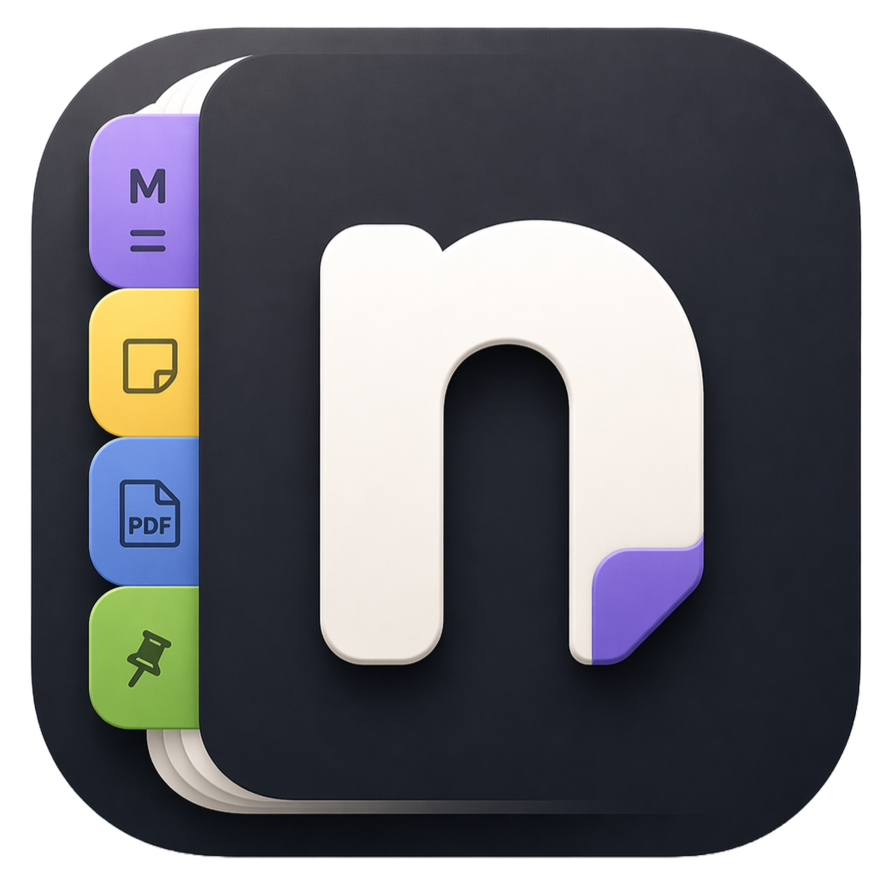

<p align="center">
  
</p>

<h1 align="center">Notiq</h1>

<p align="center">
  A fast, local-first Markdown editor with an encrypted vault, a whiteboard and a knowledge graph.<br/>
  No accounts. No telemetry. Everything stays on your computer.
</p>

<p align="center">
  <a href="https://trexolab-solution.github.io/notiq/"><b>Website</b></a> &nbsp;·&nbsp;
  <a href="https://github.com/trexolab-solution/notiq/releases/latest"><b>Download</b></a> &nbsp;·&nbsp;
  <a href="https://github.com/trexolab-solution/notiq/issues"><b>Issues</b></a> &nbsp;·&nbsp;
  <a href="https://trexolab-solution.github.io/notiq/privacy.html"><b>Privacy</b></a>
</p>

<p align="center">
  <a href="https://github.com/trexolab-solution/notiq/releases/latest"></a>
  <a href="https://github.com/trexolab-solution/notiq/blob/main/LICENSE"></a>
  <a href="https://github.com/trexolab-solution/notiq/stargazers"></a>
  <a href="https://tauri.app/"></a>
</p>

---

## What it is

Notiq is a desktop app for notes, secrets and servers that you want to keep on your own machine. Write Markdown in the editor engine behind VS Code, keep passwords, SSH keys and private notes in one encrypted vault, and open your servers in a built-in terminal and file manager. It starts in under a second and works offline.

## Highlights

| | |
|---|---|
| **Markdown editor** | Monaco with Source, Preview and Split views. Tables, task lists, Mermaid, LaTeX and `[[wiki links]]`. Tabs, 13 themes, plain `.md` files on your disk. |
| **Secure Vault** | Passwords, SSH keys, cards, Wi-Fi, identities, 2-step codes and private notes in one encrypted file, behind a master password and a recovery key. |
| **Vault Sync** | Optional. Use one vault on all your PCs, end-to-end encrypted through your own Google Drive. Off until you turn it on. |
| **Browser autofill** | A browser extension fills logins and passkeys; every request is approved in Notiq. |
| **SSH terminal and file manager** | Built-in SSH client, nothing to install. Open a saved server in a terminal, or in a file manager over SFTP: browse, edit files, drag and drop, folders, Trash, reconnect. |
| **Whiteboard and graph** | An Excalidraw canvas beside your notes, and a knowledge graph of your `[[links]]`. |
| **Terminal, sticky notes, command palette** | A shell under your notes, sticky notes that float above other windows, and `Ctrl+Shift+P` for everything. |
| **AI, only if you want it** | Off by default. Run it locally with Ollama, or use Ollama Cloud or OpenRouter with your own key. |

See all of it, with demos, on the [website](https://trexolab-solution.github.io/notiq/).

## Download

Get the latest installer from the [releases page](https://github.com/trexolab-solution/notiq/releases/latest):

- **Windows** — installer (`.exe`)
- **Linux** — AppImage or `.deb`
- **macOS** — build from source (see below)

Notiq updates itself from the same releases page (**Settings → Updates**).

## Build from source

You need [Node.js](https://nodejs.org/) 18+, [Bun](https://bun.sh/), [Rust](https://www.rust-lang.org/tools/install) and the [Tauri prerequisites](https://tauri.app/start/prerequisites/) for your system.

```bash
git clone https://github.com/trexolab-solution/notiq.git
cd notiq
bun install
bun run tauri dev      # run it
bun run tauri build    # make an installer
```

More in [DEVELOPMENT.md](DEVELOPMENT.md): tech stack, project structure, architecture and cross-compiling for Linux.

## Privacy

- Notes, drawings and settings are stored **locally**. There is **no telemetry**: no analytics, no crash reports, no accounts.
- **Vault Sync, AI and the breached-password check are opt-in and off by default.** Sync sends only the encrypted vault to your own Google Drive. AI sends only what a request needs to the service you configure (or nothing, with local Ollama). The breached-password check sends only the first 5 characters of a SHA-1 hash.
- Update checks only download the public release file from GitHub.

Details: [privacy policy](https://trexolab-solution.github.io/notiq/privacy.html) and [how the vault is protected](VAULT.md).

## Documentation

- [Website](https://trexolab-solution.github.io/notiq/): features, demos and downloads
- [Keyboard shortcuts](SHORTCUTS.md)
- [The Secure Vault](VAULT.md): entry types, security model, sync and autofill
- [Developing Notiq](DEVELOPMENT.md)

## Contributing

Contributions are welcome. Fork the repository, make a focused change, check that `bun run tauri dev` still works, and open a pull request that says what changed and why. For bugs and ideas, [open an issue](https://github.com/trexolab-solution/notiq/issues).

## License

[MIT](LICENSE) © TrexoLab
